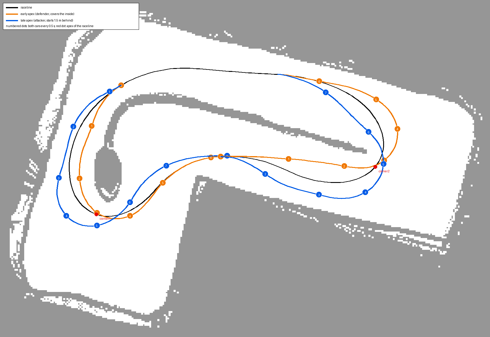
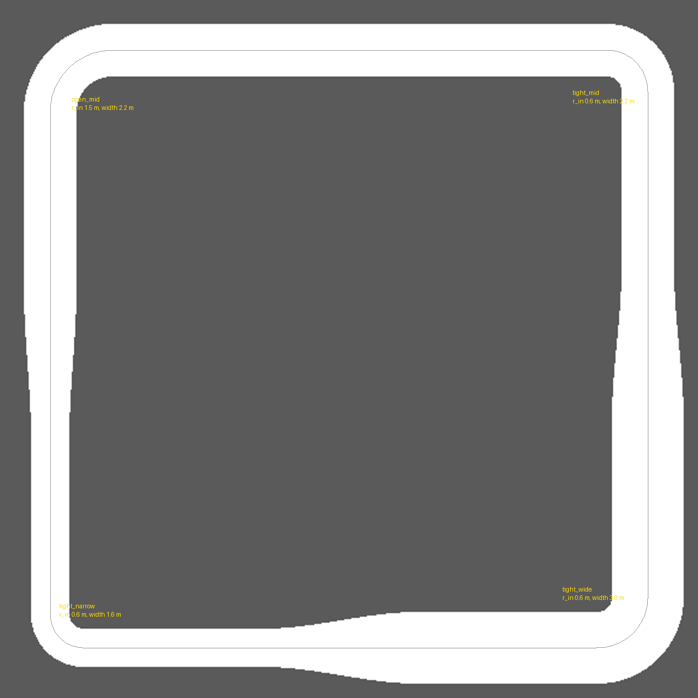

# Head-to-head racing for F1TENTH: see the other car, follow it, pass it

A head-to-head layer on top of an MPPI raceline controller for 1/10-scale race cars.
The car finds other cars with its **LiDAR only**, estimates where they are going, and
decides between four behaviours: drive its own line, **follow**, **pass**, or take a
**switchback** through a corner the car ahead is defending.

Nothing the simulator knows about the other cars (their odometry) reaches the controller:
on the real car the laser scan is all there is, so that is all the code uses.

```
 /scan + static map                                   raceline (x, y, yaw, v)
        |                                                      |
        v                                                      v
 OpponentTracker  -- tracks (s, d, vs, vd) -->  Tactician  -->  shifted reference line
 clusters + Kalman filter                       FREE / FOLLOW /   + speed cap
        |                                       PASS / SWITCHBACK       |
        |                                                               v
        +------- predicted opponent poses over the horizon ---------> MPPI --> /drive
```

The MPPI controller itself (dynamics, sampling, static-obstacle avoidance) is the team's
course controller and is not described here. Everything below is in
[mppi/scripts/h2h.py](mppi/scripts/h2h.py), plus the moving-car cost in
[mppi/scripts/mppi_node.py](mppi/scripts/mppi_node.py).

## 1. Seeing the opponent

`OpponentTracker` turns each scan into a list of tracked cars.

1. **What is not the track is a car.** Scan returns are projected into the map frame. A
   return closer than 0.25 m to a wall of the static map is wall; the rest are candidates.
   This is purely geometric, so an opponent driving at exactly the ego's speed is found
   just as well as a slow one.
2. **Clusters.** Consecutive candidates are split where they are more than 0.3 m apart.
   A cluster needs at least 3 returns and may be at most 0.9 m across.
3. **One Kalman filter per car.** State `[x, y, vx, vy]` in the map frame,
   constant-velocity model, position measurements. Detections are matched to tracks by
   nearest neighbour inside a 0.8 m gate. A track counts after 5 hits and coasts for
   0.6 s without a detection.
4. **Frenet coordinates.** Each track is projected onto the raceline: station `s`, sideways
   offset `d`, speed along the line `vs` and across it `vd`. All decisions are made in
   these coordinates, so "ahead", "inside" and "how much room is left to the wall" are
   one-dimensional questions.

Two details matter on the real car:

- **The laser does not see a car, it sees a box.** The scan plane is above most of the
  chassis; what is guaranteed to be there is the 12 x 12 cm box the rules require at the
  back of every car. The tracker is tuned on that box, and the car's centre is placed ahead
  of it along the raceline's direction (the velocity direction from so few returns is too
  noisy to use as a heading).
- **Standing or moving.** A track is "moving" above 0.4 m/s along the line, with
  hysteresis. Moving cars are removed from the scan before the static-obstacle code sees
  it, so they are handled once, as cars.

## 2. Deciding: FREE / FOLLOW / PASS / SWITCHBACK

`Tactician` looks at the nearest moving car ahead and picks a state every control step.

**FOLLOW** is an adaptive-cruise speed cap, the lowest of three:

- a gap law: the opponent's speed plus a gain on the error to the wanted bumper gap
  (`follow_gap + follow_time * v`);
- a braking law: never faster than the ego can still brake down to the opponent's speed in
  the gap it has, after its own reaction time (pose age + control step + actuation);
- never much above the ego's current speed, so the controller does not accelerate at its
  limit into a cap that is about to drop.

The opponent's speed used here is the one it is *about to have*: it will brake for the
corner in front of it, as the raceline's speed profile does, scaled by its current pace.

**PASS** starts where the ego is meaningfully faster and there is a straight stretch with
room to move up *next to* the opponent, on either side. The pass does not have to be
finished before the straight ends:

- The planner predicts where the opponent will be while the ego closes from "first overlap"
  to "side by side", and searches that stretch of the opponent's path for enough width
  between the car and the wall and low enough curvature.
- The opponent's speed is predicted from its **pace** (its speed relative to the raceline's
  profile, averaged over the last seconds), not from its speed at one instant.
- It chooses the side that opens first; if both do, the one that stays open longer, with a
  preference for the inside of the next corner.
- The ego may wait behind the car for the room to open, and may change sides once.
- A pass does not start while the ego is itself in a corner, with a bend just ahead on its
  own path, or right behind the other car's bumper.
- A pass that is not working is given up, and the ego drops back gently beside the car
  instead of braking hard.

**Holding the inside.** Once the ego is beside the opponent, on the inside of the corner
ahead, and faster (or its nose is in front), the corner is the ego's: it keeps its line and
speed, and the opponent is predicted to stay on its offset.

**SWITCHBACK** is for a car that defends the inside before a corner. Following it into the
corner on the raceline is pointless, because the raceline's apex is where the other car is.
The ego instead takes the **late-apex line**: wide on the way in, a later and tighter
turn, then out on the inside while the defender, who turned in early, runs wide.


*Orange: defender on the early-apex line. Blue: attacker on the late-apex line. Equal
numbers are the same instant. The attacker crosses behind the defender at the apex and is
ahead on the following straight.*

The late-apex and early-apex lines are computed offline per corner with the same lap-time
model as the raceline ([scripts/make_apex_lines.py](scripts/make_apex_lines.py)). They are
stored as sideways offsets from the raceline, one per waypoint, so switching lines is
switching arrays.



A switchback starts only when the opponent really is on the inside, the ego is close
enough, and it has the entry speed. It is given up before the turn-in if the opponent goes
to the outside after all.

The late-apex line is defined by where the *defender* is, not by the raceline: 0.6 m outside
of the defender's line on the way in, 0.6 m inside of it on the way out, and otherwise as
fast as possible. In a wide corner, where the raceline comes in from the outside anyway, it
is then nearly the raceline; only as much of a detour as it takes to leave the inside to the
other car.

After the turn-in the ego no longer follows a fixed line. The late-apex line and the
defender's line both end on the raceline, and two cars next to each other cannot:

- **The cut-back lane.** Once the ego is on the inside of the defender, its reference is the
  late-apex line moved further in wherever that car will be next to it (`sb_offsets`).
- **In line, no faster than it can brake.** While the ego crosses the defender's track from
  the outside to the inside it is right behind it, and closes in only as fast as it could
  still brake.
- **Finishing.** Where the lines are together again and the ego is not clear of the car yet,
  the switchback is handed over as a pass on the inside instead of back to following.
- **Timing.** The two lines cross once, around the apex, and next to the defender there is
  the one place the ego must not be. From the line model (both lines' speed profiles from
  where the cars are now) the ego is either at the crossing clearly first, or it scales its
  speed to arrive just behind the defender, still faster than it. The defender is predicted
  along its line (inside wall to outside wall within a second), not on the offset it has now,
  and the ego does not brake behind a car that will have moved out of its way.

Each corner also carries the line model's prediction of what the late-apex line gains on a
car covering the inside there (`gain_m`); corners predicted to gain less than
`h2h_sb_min_gain` (1 m) are not armed.

## 3. Acting: what the controller receives

The tactician never steers. It hands MPPI three things:

- **A shifted reference line.** For a pass, the raceline is moved sideways next to where
  the opponent *will be*, blended back to the raceline before and after. The shift is
  limited to 0.2 m sideways per metre, starts from the car's own position, is kept inside
  the track, and gets its own curvature-based speed profile.
- **A speed cap** for following.
- **Predicted opponent poses** over the horizon, for up to three cars: each keeps its speed
  along the raceline and its sideways offset. MPPI's cost has a hard term for contact and a
  soft margin around each car, evaluated at the matching time step of every rollout. The
  soft margin is smaller for the car being passed, because next to it is where the ego
  wants to be.

## 4. A simulator that behaves like the car

The two-car simulation is built on
[f1tenth_gym_ros](https://github.com/f1tenth/f1tenth_gym_ros) with a few extra nodes, so that
what is tuned in simulation is tuned for the real car:

| Node | What it does |
| --- | --- |
| [scan_box_node.py](mppi/scripts/scan_box_node.py) | Replaces each opponent's full body in the simulated scan with its 12 cm rear box. |
| [latency_node.py](mppi/scripts/latency_node.py) | Adds the delays measured on the car: late pose, slow control rate, actuation lag (about 0.3 s in total). |
| [pose_fusion_node.py](mppi/scripts/pose_fusion_node.py) | Brings the late particle-filter pose up to now with wheel speed and gyro. |
| [opponent_node.py](mppi/scripts/opponent_node.py) | A pure-pursuit opponent with a speed scale and a sideways offset. The opponent can also run the same MPPI as the ego. |

## Running it

Requirements: ROS 2 Jazzy with [f1tenth_gym_ros](https://github.com/f1tenth/f1tenth_gym_ros)
(`dev-jazzy` branch) in the same workspace, and Python with `jax`, `numpy`, `scipy`.

```bash
colcon build --packages-select mppi
source install/setup.bash
```

```bash
ros2 launch mppi h2h_sim_launch.py                       # ego vs one slow opponent (0.6x)
ros2 launch mppi h2h_sim_launch.py opp_speed_scale:=0.9 opp_offset:=-0.3
ros2 launch mppi h2h_sim_launch.py num_agents:=4         # four cars
ros2 launch mppi h2h_sim_launch.py h2h_pass:=false       # follow only
ros2 launch mppi h2h_sim_launch.py h2h:=false            # baseline: no head-to-head logic
ros2 launch mppi h2h_sim_launch.py latency:=false        # ideal simulator, no delays
ros2 launch mppi h2h_sim_launch.py open_foxglove:=true   # with the viewer
```

One local change to the simulator is needed for close racing: f1tenth_gym compiles its
car-to-car contact code the first time two cars' bounding boxes overlap, and the whole
simulation stands still for about 0.3 s just as two cars come side by side.
[patches/f1tenth_gym_pair_contact_warmup.patch](patches/f1tenth_gym_pair_contact_warmup.patch)
compiles it at start-up instead (`git apply` it in `f1tenth_gym_ros/f1tenth_gym`).

Switchback test, two equal cars, the opponent on the early-apex line and the ego 1.5 m
behind it:

```bash
ros2 launch mppi h2h_sim_launch.py latency:=false pace:=race raceline:=race2_raceline_opt.csv \
    opp_controller:=mppi opp_line:=race2_raceline_opt_earlyapex.csv start_gap:=1.5 \
    switchback:=race2_raceline_opt_apex.json
```

### Switchback test tracks

Three generated tracks with nine corners that differ in how far the track turns, how tight the
inside wall is and how wide the track is ([scripts/make_test_track.py](scripts/make_test_track.py)):

| Track | Corner | Turn | Inside radius | Width |
| --- | --- | --- | --- | --- |
| `sbt_a` | `tight_wide` | 90 deg | 0.6 m | 3.0 m |
| `sbt_a` | `tight_mid` | 90 deg | 0.6 m | 2.2 m |
| `sbt_a` | `open_mid` | 90 deg | 1.5 m | 2.2 m |
| `sbt_a` | `tight_narrow` | 90 deg | 0.6 m | 1.6 m |
| `sbt_b` | `hairpin_wide` | 180 deg | 0.6 m | 3.0 m |
| `sbt_b` | `hairpin_mid` | 180 deg | 1.0 m | 2.2 m |
| `sbt_c` | `acute_wide` | 135 deg (acute corner) | 0.6 m | 3.0 m |
| `sbt_c` | `acute_mid` | 135 deg (acute corner) | 0.6 m | 2.2 m |
| `sbt_c` | `square_mid` | 90 deg | 1.0 m | 2.2 m |



Every track has a raceline and the defender's / attacker's lines per top speed (4, 5 and
6 m/s; a line set is `<track>_v<speed>`):

```bash
scripts/sb_setup.sh                     # maps, racelines, defender / attacker lines
```

```bash
colcon build --symlink-install --packages-select mppi
```

```bash
scripts/sb_test.py sbt_a                # every corner at 4, 5 and 6 m/s: car ahead defends / does not
```

```bash
scripts/sb_plot.py /tmp/sb_test/sbt_a_v6_tight_wide_defend_1.npy     # what the two cars drove
```

```bash
scripts/sb_replay.py sbt_a tight_wide --speed 6     # watch one corner in Foxglove, over and over
```

`sb_replay.py` starts the simulator once and puts both cars back in front of the corner
every time they are through it (Foxglove on port 8766; switch on `/h2h/markers`).

`sb_test.py` runs one corner at a time and reports, from the simulator's ground truth,
whether the switchback started, the gap before and after the corner, the closest the cars
came and any contact. The two cars run the same controller at the same pace through the
corner and after it; on the straight before it the car ahead drives at 0.85 of its speed
(`--opp-straight`), so that the ego arrives right behind a car it cannot pass on the straight.
The same tracks run as an ordinary race:

```bash
ros2 launch mppi h2h_sim_launch.py map:=sbt_a raceline:=sbt_a_v6_raceline.csv pace:=race latency:=false \
    opp_controller:=mppi opp_line_set:=sbt_a_v6_raceline_apex.json switchback:=sbt_a_v6_raceline_apex.json \
    car_params:='{"v_max": 6.0, "max_speed": 6.5}' start_gap:=3 start_s:=40 sync_start:=10 open_foxglove:=true
```

One measured run (lap times, overtakes, collisions, closest distance):

```bash
scripts/run_h2h.sh 60 /tmp/run.json opp_speed_scale:=0.6
```

The head-to-head parameters are the `h2h_*` parameters of `mppi_node.py`; the full list of
launch arguments is at the top of
[mppi/launch/h2h_sim_launch.py](mppi/launch/h2h_sim_launch.py).

## Where things are

| Path | Content |
| --- | --- |
| `mppi/scripts/h2h.py` | `TrackFrame` (Frenet frame + free width from the map), `OpponentTracker`, `Tactician`, opponent prediction |
| `mppi/scripts/mppi_node.py` | MPPI controller, the moving-car cost, and the glue (`h2h_step`) |
| `mppi/scripts/lines.py` | Alternative racing lines as offsets from the raceline, and their speed profiles |
| `mppi/launch/h2h_sim_launch.py` | Two-car (up to four-car) simulation |
| `scripts/optimize_raceline.py` | Minimum-lap-time raceline for a map |
| `scripts/make_apex_lines.py` | Early-apex and late-apex lines per corner |
| `scripts/make_test_track.py`, `scripts/sb_setup.sh` | Switchback test tracks: corners of different inside radius and width |
| `scripts/sb_test.py`, `scripts/sb_plot.py` | Switchback test corner by corner, and a picture of a run |
| `scripts/sb_replay.py` | One corner replayed in the simulator for the viewer |
| `scripts/h2h_monitor.py`, `scripts/run_h2h.sh` | Measure a run: overtakes, collisions, gaps |
| `scripts/draw_switchback.py` | The switchback picture above |
| `patches/` | The start-up fix for the simulator's first-contact freeze |
| `test_results/` | Results and pictures of the switchback tests |

## Status

Work in progress, tested in simulation only; the head-to-head layer has not run on the
real car yet.

- At the last measured checkpoint the ego followed without contact in four 50 s runs
  (three behind a 0.92x defender, one behind an equal car), but did not complete an
  overtake against either.
- The pass logic has been reworked since then (get beside the car instead of clear ahead;
  pace-based prediction) and has not been re-measured in the same way.
- Switchback on the test tracks (`scripts/sb_test.py`; no delays, a_lat 4.3 m/s^2, a_lon
  2.5 m/s^2; results and a picture of every run in `test_results/switchback_2026-11-23/`).
  54 runs, every corner at 4, 5 and 6 m/s top speed, once with the car ahead covering the
  inside and once with it on the raceline: the switchback started in 27 of 27 defended runs
  and in 0 of 27 others; no contact in any run. Gap to the car ahead [m] at the decision ->
  8 m after the corner (+ = the ego is behind; **bold** = overtaken):

  | Corner | 4 m/s | 5 m/s | 6 m/s |
  | --- | --- | --- | --- |
  | `tight_wide` (90 deg, wide) | +1.3 -> +1.3 | **+1.6 -> -2.2** | **+2.1 -> -2.9** |
  | `square_mid` (90 deg, inside radius 1.0 m) | **+1.2 -> -0.6** | +1.4 -> +0.1 | **+1.6 -> -2.2** |
  | `acute_wide` (135 deg, wide) | +1.3 -> +1.3 | +1.7 -> +1.3 | +1.7 -> +1.0 |
  | `tight_mid` (90 deg) | +1.3 -> +1.3 | +1.6 -> +1.3 | +1.8 -> +1.6 |
  | `open_mid` (90 deg, inside radius 1.5 m) | +1.3 -> +1.3 | +1.5 -> +1.2 | +1.8 -> +2.6 |
  | `acute_mid` (135 deg) | +1.3 -> +1.3 | +1.7 -> +1.4 | +2.0 -> +2.4 |
  | `tight_narrow` (90 deg, 1.6 m wide) | +1.3 -> +1.3 | +1.6 -> +1.4 | +1.5 -> +2.7 |
  | `hairpin_wide` (180 deg) | +1.3 -> +1.3 | +1.8 -> +2.1 | +2.1 -> +3.3 |
  | `hairpin_mid` (180 deg) | +1.3 -> +1.4 | +1.4 -> +2.6 | +2.0 -> +3.7 |

  Repeats of the three best corners: `tight_wide` 4 of 4 overtakes at 5 m/s and 4 of 4 at
  6 m/s; `square_mid` 0 of 3 at 5 m/s (twice level with the other car) and 3 of 3 at 6 m/s;
  `acute_wide` 0 of 3 at 5 m/s and 1 of 3 at 6 m/s. With the switchback switched off against
  the same defender (4 runs) the ego stayed behind and lost 0.2-1.2 m through the corner.
  What it shows: the switchback needs a corner the defender has to brake for and room to cut
  back. At 4 m/s these corners are nearly flat out on any line; in the hairpins and the narrow
  corners the inside line costs the defender nothing, and going wide loses ground. The line
  model's `gain_m` does not predict this well (it promises 1.5-2 m in `hairpin_wide`): choose
  the corners from a test like this one (`h2h_sb_corners`) rather than by `h2h_sb_min_gain`.
  One run per cell, on a computer that was also running another simulation.
- Judging corners by the speed actually driven there (`h2h_grip_use`) is off by default:
  it enabled a pass on the inside into a hairpin, but also caused a crash in testing.

## Credits

Built on the team's MPPI controller from ESE 6150 (University of Pennsylvania) and on the
F1TENTH gym simulator. See [LICENSE](LICENSE).
